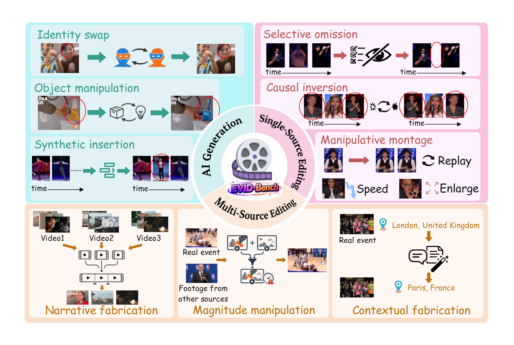

<div align="center">
  
  <br/>

[](#-quick-start) [](https://github.com/yutao1024/EVID-Bench) [](#-citation) [](https://huggingface.co/datasets/Kirito-Lab/EVID-Bench/)

  ✨ **Search-grounded video misinformation detection: retrieve external video evidence, compare across sources, and explain what was falsified.** ✨

  | 🔎 **Fully Automated DeepSearch** | 🧾 **Evidence-Grounded Verification** | 🎬 **9 Manipulation Types** |
</div>


## 📑 Table of Contents

<div align="center">

[🔥 News](#-news) · [🌈 Overview](#-overview) · [🤗 Dataset](#-dataset) · [🚀 Quick Start](#-quick-start)  
[🧪 Run](#-run-evid-bench) · [📦 Outputs](#-outputs) · [🛠 Troubleshooting](#-troubleshooting) · [📖 Citation](#-citation)

</div>


## 🔥 News

**[2026/06/05]** 📄 Paper will be available on arXiv. Paper link: `PLACEHOLDER_ARXIV_URL`.

**[2026/06/02]** 🤗 EVID-Bench dataset is now available on Hugging Face! Explore the [Dataset](https://huggingface.co/datasets/Kirito-Lab/EVID-Bench/).


## 🌈 Overview

<div align="center">
  
</div>
<br/>

EVID-Bench studies a setting where a video cannot be verified from pixels alone. A system must search the open web for related videos, compare the input with retrieved evidence, and identify the false or manipulated information.

The benchmark contains **222 manipulated videos** spanning **9 manipulation types** across **3 categories** and **6 topic domains**. The baseline in this repository implements a retrieval-augmented verification pipeline:

```text
Input video
  -> CoT frame analysis
  -> DeepSearch loop: search -> download -> coarse filter -> fine contrastive extraction
  -> sufficiency / reflection
  -> multi-judge scoring against ground truth
```

### Manipulation Taxonomy

- **AI Generation:** identity swap, synthetic insertion, object manipulation.
- **Single-Source Editing:** selective omission, causal inversion, manipulative montage.
- **Multi-Source Editing:** narrative fabrication, magnitude manipulation, contextual fabrication.

## 🤗 Dataset

Download from Hugging Face: [EVID-Bench Dataset](https://huggingface.co/datasets/Kirito-Lab/EVID-Bench/).

Put the manifest at the dataset root and forged videos under `videos/`. The folder name is flexible; pass that root (or the manifest path) to the CLI.

```text
data/EVID-Bench/              # example local root
├── evid_bench.json           # default manifest (222 entries)
└── videos/
    ├── <forged_video_id>.mp4 # stem must match manifest id
    └── ...
```

Manifest format: a JSON **array** of entries. Values use **snake_case** (as in the released `evid_bench.json`):

```json
{
  "id": "<forged_video_id>",
  "source": ["<source_youtube_id>", "..."],
  "task": {
    "category": "<manipulation_category>",
    "type": "<manipulation_type>"
  },
  "topic": "<topic_category>",
  "groundtruth": ["<forgery_point>", "..."]
}
```

- **`id`**: forged (manipulated) video ID; must match `videos/<id>.mp4` (flat `<id>.mp4` next to the manifest still works as a fallback).
- **`source`**: YouTube IDs of the original footage (one for single-source tasks; two or more for multi-source tasks). Required for oracle retrieval checks.
- **`task`**: `category` + `type` — see the taxonomy table below for allowed snake_case values.
- **`topic`**: one of `daily_life`, `education_and_skills`, `on_scene_footage`, `sports`, `performance_and_talent`, `reviews`.
- **`groundtruth`**: forgery points as a string list.

| `task.category` | `task.type` values |
| --- | --- |
| `ai_generation` | `identity_swap` · `synthetic_insertion` · `object_manipulation` |
| `single_source_editing` | `selective_omission` · `causal_inversion` · `manipulative_montage` |
| `multi_source_editing` | `narrative_fabrication` · `magnitude_manipulation` · `contextual_fabrication` |

### Download & Run Evaluation Only

If you only want to **run the released benchmark** (not build new data), download from Hugging Face, unzip, and keep this layout:

```text
data/EVID-Bench/
├── evid_bench.json
└── videos/
    └── <forged_video_id>.mp4
```

Configure [`.env`](#configuration), then evaluate one sample or the full manifest:

```bash
# One sample (recommended first)
python -m src.cli data/EVID-Bench/ --only-ids <forged_video_id> --num-workers 1

# Full benchmark folder
python -m src.cli data/EVID-Bench/
```

Add `--search-only` to test search recall against `source` without downloading candidates. Add `--skip-judge` when `groundtruth` is empty or you only need retrieval traces.

## 🚀 Quick Start

These steps assume a fresh machine and are intentionally explicit.

- [Prerequisites](#prerequisites)
- [Environment Check](#environment-check)
- [Installation](#installation)
- [Configuration](#configuration)

### Prerequisites

Before installation, install:

- **Python** 3.11+
- **FFmpeg** and `ffprobe` (frame extraction and video probing)
- **Node.js** (required by `yt-dlp` for YouTube JavaScript challenges; Deno or Bun also work)

If these tools are missing, or you are on a machine without `sudo`, use one of the install paths below. No root access is required for the local Linux steps.

#### macOS

```bash
brew install ffmpeg node
```

#### Ubuntu / Debian (with `sudo`)

```bash
sudo apt-get update
sudo apt-get install -y ffmpeg nodejs npm
```

#### Install FFmpeg locally (Linux, no `sudo`)

1. Download a static build, for example:
   ```bash
   wget https://johnvansickle.com/ffmpeg/releases/ffmpeg-release-amd64-static.tar.xz
   tar -xf ffmpeg-release-amd64-static.tar.xz
   ```
2. Copy binaries into `~/.local/bin`:
   ```bash
   mkdir -p ~/.local/bin
   cp ffmpeg-*-static/ffmpeg ffmpeg-*-static/ffprobe ~/.local/bin/
   ```
3. Add to `PATH` and reload your shell:
   ```bash
   echo 'export PATH="$HOME/.local/bin:$PATH"' >> ~/.bashrc
   source ~/.bashrc
   ```
4. Verify: `ffmpeg -version` and `ffprobe -version`.

#### Install Node.js locally (Linux, no `sudo`)

1. Download a prebuilt binary, for example:
   ```bash
   wget https://nodejs.org/dist/v20.11.0/node-v20.11.0-linux-x64.tar.xz
   tar -xf node-v20.11.0-linux-x64.tar.xz
   ```
2. Copy `node` into `~/.local/bin` (create the directory if needed).
3. Verify: `node --version`.

> **Windows:** install Python, FFmpeg, and Node.js from [python.org](https://www.python.org/), [ffmpeg.org](https://ffmpeg.org/download.html), and [nodejs.org](https://nodejs.org/), then add their `bin` directories to `PATH`.

### Environment Check

Run these commands before installing Python packages. If any command is missing, fix the corresponding dependency first.

```bash
python --version
ffmpeg -version
ffprobe -version
node --version
```

Expected results:

- `python --version` should show Python 3.11 or newer.
- `ffmpeg -version` and `ffprobe -version` should print version information, not `command not found`.
- `node --version` should print a version such as `v20.x.x`.

### Installation

#### 1. Clone this repository and navigate to the folder

```bash
git clone https://github.com/yutao1024/EVID-Bench.git
cd EVID-Bench
```

#### 2. Create a Python environment

Use one of the following. All later commands assume the environment is activated.

**Option A: Conda (recommended)**

```bash
conda create -n evid-bench python=3.11 -y
conda activate evid-bench
```

**Option B: `venv` (Debian/Ubuntu servers)**

```bash
sudo apt update && sudo apt install -y python3.11 python3.11-venv ffmpeg nodejs npm
python3.11 -m venv .venv
source .venv/bin/activate
```

**Option C: `virtualenv` (fallback)**

```bash
pip install --user virtualenv
python -m virtualenv .venv
source .venv/bin/activate
```

#### 3. Install Python dependencies

```bash
pip install -r requirements.txt
python -m src.cli --help
```

If `python -m src.cli --help` prints the command-line options, the package import path and dependencies are working.

### Configuration

Copy the environment template from the repository root:

```bash
cp .env.example .env
```

Edit `.env` and fill the required keys:

```bash
OPENAI_API_KEY=your_openai_or_openrouter_key
OPENAI_BASE_URL=https://openrouter.ai/api/v1
SERPER_KEY=your_serper_key
```

- **`OPENAI_API_KEY`** is required. It can be an OpenAI key, an OpenRouter key, or another OpenAI-SDK-compatible gateway key.
- **`OPENAI_BASE_URL`** is optional. The default example uses OpenRouter. For official OpenAI, use `https://api.openai.com/v1`.
- **`SERPER_KEY`** is required for Google search through [Serper](https://serper.dev). If this is missing or invalid, retrieval will not find web candidates.

**Model roles (CLI flags, not `.env`):** `--reasoning-model` drives frame analysis, search planning, candidate filtering, and cross-video comparison; `--judge-models` is a comma-separated panel that scores model outputs against `groundtruth`. Use a strong VLM for `--reasoning-model` and your preferred judge models for scoring.

#### How to obtain API keys

| Key / setting | Where to get it | Used for |
| --- | --- | --- |
| `OPENAI_API_KEY` | [OpenAI](https://platform.openai.com/), [OpenRouter](https://openrouter.ai/), or another OpenAI-compatible gateway | VLM calls and judge requests |
| `OPENAI_BASE_URL` | Provider documentation (OpenRouter default in `.env.example`) | API endpoint |
| `SERPER_KEY` | Sign up at [serper.dev](https://serper.dev) | YouTube/web search during DeepSearch |

Make sure keys are valid and have enough quota before a full-folder run.

#### YouTube cookies (recommended for downloads)

The pipeline downloads candidate videos with `yt-dlp`. Age-restricted or bot-checked videos usually need cookies from a logged-in YouTube session.

1. Log in to YouTube in your browser.
2. Export Netscape-format `cookies.txt` with an extension such as [Get cookies.txt LOCALLY](https://chromewebstore.google.com/detail/get-cookiestxt-locally/cclelndahbckbenkjhflpdbgdldlbecc) (Chrome/Edge) or **cookies.txt** (Firefox).
3. Save the file and set an **absolute path** in `.env`:

```bash
YT_DLP_COOKIES_FILE=/absolute/path/to/cookies.txt
```

Alternatively, read cookies directly from a local browser (no file export):

```bash
YT_DLP_COOKIES_FROM_BROWSER=chrome
```

Optional runtime tuning:

```bash
FRAME_RESIZE_WORKERS=16
PIPELINE_LOG_DIR=/absolute/path/to/logs
```

Most users can leave these unset.

## 🧪 Run EVID-Bench

A full run searches the web, downloads candidates, calls VLMs, and optionally scores against `groundtruth`. Work through the profiles below in order; confirm `python -m src.cli --help` works before Profile 1.

Replace `data/EVID-Bench/` and `<forged_video_id>` with your paths. Pass the dataset folder (expects `evid_bench.json` inside) or a direct path such as `data/EVID-Bench/evid_bench.json`.

### Recommended Run Profiles

**Profile 1 — Debug / smoke**  
Search-only: checks whether results hit manifest `source` IDs. No candidate download or visual comparison.

```bash
python -m src.cli data/EVID-Bench/ \
  --only-ids <forged_video_id> \
  --search-only \
  --num-workers 1
```

**Profile 2 — Single-video retrieval (no judge)**  
End-to-end retrieval on one video with lower cost. Inspect `_debug/results.jsonl`, `_debug/run_trace.jsonl`, and `_debug/logs/`.

```bash
python -m src.cli data/EVID-Bench/ \
  --only-ids <forged_video_id> \
  --num-workers 1 \
  --candidate-video-height 360 \
  --max-deepsearch-rounds 3 \
  --total-sample-frames 32 \
  --save-run-trace \
  --skip-judge \
  --output _debug
```

**Profile 3 — Single-video full evaluation**  
Default benchmark settings with multi-judge scoring.

```bash
python -m src.cli data/EVID-Bench/ \
  --only-ids <forged_video_id> \
  --num-workers 1 \
  --candidate-video-height 480 \
  --max-deepsearch-rounds 6 \
  --total-sample-frames 64 \
  --save-run-trace \
  --reasoning-model gpt-5.5 \
  --judge-models "gpt-5.4,gemini-3.1-pro-preview,claude-sonnet-4.6"
```

**Profile 4 — Full folder**  
Run the whole manifest after Profile 3 succeeds. Use `--limit 5` for a small batch first.

```bash
python -m src.cli data/EVID-Bench/ --num-workers 1
```

Increase `--num-workers` only after sequential runs are stable.

### Common Arguments


| Argument                              | Default                                            | Description                                                                           |
| ------------------------------------- | -------------------------------------------------- | ------------------------------------------------------------------------------------- |
| `input_path`                          | required                                           | Folder containing videos and manifest, or a direct manifest JSON path.                |
| `--manifest`                          | `evid_bench.json`                                  | Manifest filename when `input_path` is a folder.                                      |
| `--output`                            | `_results`                                         | Output directory under the data folder. `_results` expands to `_results_<timestamp>`. |
| `--only-ids`                          | all                                                | Comma-separated video IDs to run.                                                     |
| `--limit`                             | all                                                | Run only the first `N` manifest entries.                                              |
| `--num-workers` / `--parallel-videos` | `1`                                                | Number of videos to process in parallel.                                              |
| `--candidate-video-height`            | `480`                                              | Frame/video resize height for candidates and cached sampled frames.                   |
| `--total-sample-frames`               | `64`                                               | Input frames for CoT, fine extraction, sufficiency, and reflection.                   |
| `--coarse-sample-frames`              | `16`                                               | Frames per side for coarse relevance filtering.                                       |
| `--candidate-sample-frames`           | same as total                                      | Candidate frames for fine extraction.                                                 |
| `--max-deepsearch-rounds`             | `6`                                                | Maximum DeepSearch search rounds.                                                     |
| `--max-reflect-rounds`                | `3`                                                | Maximum reflection rounds after search failure.                                       |
| `--reasoning-model`                   | `google/gemini-2.5-pro`                            | VLM used for reasoning and cross-video comparison.                                  |
| `--judge-models`                      | `gpt-5.5,gemini-3.1-pro-preview,claude-sonnet-4.6` | Comma-separated judge models for ground-truth scoring.                              |
| `--judge-model`                       | unset                                              | Single-judge override.                                                                |
| `--save-run-trace`                    | off                                                | Write structured trace rows.                                                          |
| `--results-jsonl`                     | `results.jsonl`                                    | Results JSONL path, relative paths resolved under output dir.                         |
| `--trace-jsonl`                       | `run_trace.jsonl`                                  | Trace JSONL path, relative paths resolved under output dir.                           |
| `--resume` / `--no-resume`            | resume                                             | Reuse or ignore rows already in `results.jsonl`.                                      |
| `--skip-judge`                        | off                                                | Run retrieval only, skip ground-truth judging.                                        |
| `--skip-summary`                      | off                                                | Do not write summary files.                                                           |
| `--download-dir`                      | `downloads`                                        | Candidate download directory, resolved from current working directory.                |


## 📦 Outputs

For a manifest run on `data/EVID-Bench/`, outputs are written under the dataset folder. The default `--output _results` is expanded to a timestamped directory so that separate runs do not overwrite each other:

```text
data/EVID-Bench/
└── _results_YYYYMMDD_HHMMSS/
    ├── results.jsonl
    ├── run_trace.jsonl          # only with --save-run-trace
    ├── summary.json             # skipped by --skip-summary
    ├── summary.md               # skipped by --skip-summary
    └── logs/
        └── run_<timestamp>_<video_id>.log
```

What each file is for:

- **`results.jsonl`**: one JSON record per processed video. This is the main machine-readable result file. It includes the video ID, task/topic metadata, retrieval hits, collected evidence, judge overview, token usage, and errors if any.
- **`run_trace.jsonl`**: written only with `--save-run-trace`. Use it to debug search behavior: generated queries, candidate URLs, candidate titles, filtering decisions, and round-by-round stopping reasons.
- **`summary.json`**: aggregate metrics in JSON format, useful for scripts or spreadsheets.
- **`summary.md`**: human-readable aggregate summary, useful for quick inspection.
- **`logs/run_<timestamp>_<video_id>.log`**: per-video console log. Open this first when a specific sample fails.

### Result fields

**`results.jsonl` (one JSON object per line, per video)**

| Field | Meaning |
| --- | --- |
| `video_id` | Forged video ID from the manifest |
| `task`, `topic` | Labels from the manifest entry |
| `retrieval.truth_hit` | Whether any expected `source` ID was retrieved |
| `retrieval.retrieved_truth_ids` | Subset of `source` IDs found during search/download |
| `retrieval.expected_source_ids` | Oracle IDs from manifest `source` |
| `retrieval.matched_urls` | Candidate URLs kept after filtering |
| `deepsearch.collected_forgery_points` | Forgery points extracted during retrieval |
| `judge_overview.score` | Point-level judge score for this video (if judging ran) |
| `judge_overview.passed_gt_count` / `n_gt` | How many ground-truth points passed vs total |
| `ground_truth` | Manifest `groundtruth` copied into the record |
| `tokens` | Prompt/completion token usage (total and by model/stage) |
| `error` | Present if the run failed or was interrupted |

**`summary.json` / `summary.md` (aggregate over the run)**

| Field | Meaning |
| --- | --- |
| `n_videos` | Number of videos processed in this run |
| `n_judged` | Videos with ground-truth judging completed |
| `retrieval.retrieval_rate` | Share of videos with at least one `source` hit |
| `retrieval.per_task_breakdown` | Retrieval rate grouped by task label |
| `scoring.accuracy` | Point-level accuracy over all judged GT points |
| `scoring.hit_points` / `total_points` | Passed GT points vs total GT points |
| `scoring.per_task_breakdown` | Accuracy grouped by task label |
| `tokens.by_model` / `tokens.by_stage` | Token totals by model and by retrieval vs judge |
| `per_video` | Compact per-video table (truth hit, score, matched URLs) |

Frame caches are stored under the repository root:

```text
.frame_cache/
├── input/<video_id>_h<height>_n<num_frames>/
└── candidate/<candidate_id>_h<height>_n<num_frames>/
```

The cache avoids re-sampling the same frames on repeated runs. It is safe to delete `.frame_cache/` when you want to free disk space or force fresh frame extraction.

### Resume and Rerun

By default, EVID-Bench resumes from existing rows in `results.jsonl`:

```bash
python -m src.cli data/EVID-Bench/ --output _results_20260603_101500
```

If that output directory already contains a result for a video ID, the run skips that video. This is useful after an interrupted long run.

Use `--no-resume` when you want to force a fresh run:

```bash
python -m src.cli data/EVID-Bench/ \
  --only-ids <forged_video_id> \
  --output _rerun \
  --no-resume
```

Use explicit JSONL paths when you want stable filenames inside an output directory:

```bash
python -m src.cli data/EVID-Bench/ \
  --only-ids <forged_video_id> \
  --output _debug \
  --results-jsonl results.jsonl \
  --trace-jsonl run_trace.jsonl \
  --save-run-trace
```

Relative `--results-jsonl` and `--trace-jsonl` paths are resolved under `--output`. Absolute paths are used as-is.

## 🗂 Repository Layout

```text
.
├── src/
│   ├── cli.py                 # batch entrypoint
│   ├── agent_pipeline_v2.py   # DeepSearch orchestration
│   ├── agent/
│   │   ├── tools.py           # VLM calls, Serper search, yt-dlp, frame utilities
│   │   ├── prompts.py         # prompts for CoT, filtering, extraction, reflection
│   │   ├── judge.py           # multi-judge scoring
│   │   ├── session_state.py
│   │   └── oracle_eval.py     # manifest and oracle helpers
│   └── utils/
│       ├── config.py          # .env and runtime configuration
│       ├── frame_sampling.py
│       ├── pipeline_log.py
│       ├── token_usage.py
│       └── text_utils.py
├── assets/
│   ├── main.png
│   └── overview.png
├── requirements.txt
├── .env.example
└── README.md
```

## 🛠 Troubleshooting

**`Manifest not found`**  
Check whether you passed a folder or a JSON file. If you pass a folder, it must contain `evid_bench.json` unless you set `--manifest`:

```bash
python -m src.cli data/EVID-Bench/ --manifest MyManifest.json
```

**`video file not found`**  
The CLI looks for `videos/<id>.mp4` under the dataset folder (then `<id>.mp4` next to the manifest as fallback). If `evid_bench.json` has `"id": "abc123"`, the expected path is `data/EVID-Bench/videos/abc123.mp4`.

**`OPENAI_API_KEY` is not set.**  
Create `.env` from `.env.example`, fill `OPENAI_API_KEY`, and run from the repository root so `python-dotenv` can load `.env`.

**Search returns no candidates.**  
Check `SERPER_KEY` in `.env` (API key from https://serper.dev). Also try `--search-only --only-ids <id>` to isolate search from video download and VLM calls.

**`ffmpeg` or `ffprobe` not found.**  
Install `ffmpeg` and make sure both commands are on `PATH`. Verify with `ffmpeg -version` and `ffprobe -version`.

**YouTube download fails with 403, age checks, or bot checks.**  
Install Node.js / Deno / Bun, update `yt-dlp`, and provide cookies with `YT_DLP_COOKIES_FILE`, `YT_DLP_COOKIES_FILES`, or `YT_DLP_COOKIES_FROM_BROWSER`.

**The judge is skipped.**  
Check whether `groundtruth` is present and non-empty in the manifest. If you only want retrieval, pass `--skip-judge`; if you want ground-truth judging, fill `groundtruth`.

**The run stops early or finds weak evidence.**  
Open `run_trace.jsonl` and the corresponding log file. Increase `--max-deepsearch-rounds` after verifying that search and download work.

**The run is slow or expensive.**  
Start with `--only-ids`, `--limit 1`, `--candidate-video-height 360`, and `--skip-judge`. Increase coverage after the first end-to-end run works.

## 📖 Citation

Please kindly cite our paper if you find this project or dataset helpful.

```bibtex

```
